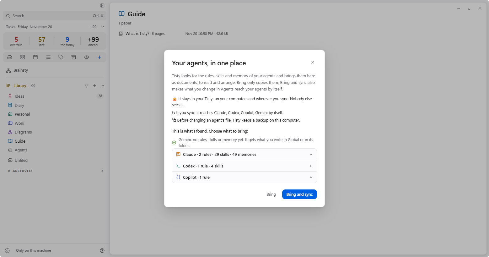

Tisty 1.49 brings three big things:

- **The Agents folder.** The rules, skills and memory of Claude Code, Codex, GitHub Copilot, Gemini and Cursor, in plain sight in one place and, if you want, kept in sync with their files.
- **Brainsty.** What joins everything you keep. You link one document to another, you cite a task inside a document, and from that Tisty builds one network: you see it and walk it, and your agent reads it over MCP to find more by reading less.
- **A history for every document.** See what changed and who changed it, and go back to an earlier version.

And several you will notice every day: Settings put in order, reminders so your agent does not forget to write things down, and fixes in the editor. It all stays on your computer, in Markdown and with no account, and it works the same with an agent or on your own.

## Your agents, in one place

Yisset works with Claude Code, Codex and GitHub Copilot, and each one reads its rules from its own file, in a different folder. Changing a rule everywhere meant opening three files, and sooner or later one fell behind.

The **Agents** folder, at the top of the Library, brings those files into Tisty as documents, with their skills and their memory. There are two ways to use it:

- **Bring** copies them, to read, search and arrange them. Your agents go on reading their usual files.
- **Bring and sync** also carries to each agent what you change in Tisty, with a backup before every write.

Every rule opens with its card: which agent reads it, which file it is written to, how many backups it has and whether it is in sync. From there you edit it, see its backups or pause the sync with that agent.

A rule written in **Global** reaches all your assistants: Yisset writes «Answer in Spanish» once, and it lands in the file of each one. A change made outside Tisty is never written over. And when Yisset asks an agent to add a rule, the agent does not write it: the change waits on the card until Yisset approves it.

Each computer decides what it applies, and Tisty reads nothing from your agents until you click the folder.

## Brainsty: what joins everything you keep

Brainsty is not one more view. It is what Tisty knows about how the things you keep connect: which document names which, which task it cites, which tag they share. Each tie used to live inside its own file, and you carried the map in your head. Now it is in one place, which you see and your agent reads.

### You make the ties as you write

Marisol keeps «House repairs», a document with the roof, the plumbing and the quotes. While writing, Marisol types two brackets and a few words of a title, and the document links to «Gutter notes»; if it is renamed later, the link still gets there. Beside each document, **Linked from** says who names it.

In the same document, the / menu cites the task «Ask for the roof quote» as a live card: its date, its steps and a box to tick right there. And **Copy link** gives an address that reaches that document from a chat, the browser or an agent, even after it moves to another folder.

### You see it as one network

Marisol opens **Brainsty**, under the task views in the sidebar. Everything Marisol keeps is there: documents as squares, tasks as circles in the colour of their list, tags as faint dots.

- **From afar** it is a map of every project, slowly turning like a globe.
- **Up close** every title shows, and a click opens the card of each thing: what it is, its dates, what points at it and its link.
- **What someone wrote weighs most:** a citation or a mention draws two things together, and a shared tag barely moves them.

See it moving on [the tisty.app home](https://www.tisty.app/).

### It joins what nobody tied, with no AI

Jaime jots «La imrpesora nueva no imprime en color», and a week later a task arrives to install the new printer. Nobody linked them, but they are about the same thing.

Brainsty brings them together with an amber curve, apart from every line someone wrote, and the card says why: two uncommon words in common, a typo, or a pair from a fixed Spanish–English word list. There is no AI model behind it: these are rules, and it all runs on your computer.

### Your agent walks the same network

The network you see is the one your agent reads over the Tisty MCP server, and what it writes is joined in it just like what you write.

Mario asks an agent how the site certificate was renewed last year. The agent finds it with a single search, the Archive included, and sees how it connects without opening anything. From a document it reads the card first, with its sections and who cites it, and then only the part it needs. What Tisty thinks is alike reaches it apart, so it never takes it for a link someone wrote.

In the MCP, searching, listing and seeing the outline of a document used to be several tools, and now they are one; reading a task or a document is another.

## Every document keeps its history

Lucas asks an agent to tidy «Saturday walks», and the document comes back without the times. In the panel beside the document, **See the history** lists its earlier versions, newest first, with who wrote each one: Lucas, or Claude Code.

- **What changed** marks in red what was taken out and in green what was put in.
- **Go back to this version** brings it back.

It works the same without an agent: a paragraph Lucas deleted by hand last week is still in an earlier version.

Tisty keeps a version when someone writes after a quiet half hour, or when the one writing changes. The versions stay on that computer, 30 days unless Lucas chooses fewer, and **Empty the history** takes away a text deleted on purpose.

## Also in this version

- **Your agent does not forget to write things down.** If you add the reminders in Settings › Assistants, every session starts with the tasks your agent left open, and a turn that changed files without noting anything in Tisty is handed back once.
- **What you put away stays away.** A task you hid or dropped, and your diary, are not in the network and do not reach your agent.
- **Settings, in order.** Eleven pages in four groups, an Overview that puts first what needs something from you, and a search for any setting.
- **Ideas, with a light bulb.** Brainstorm is now called Ideas.
- **Less in the sidebar.** A folder, the Diary or Ideas can be hidden on this computer.
- **The editor on macOS.** Keys land where the caret is, and Cmd is the command key.

## Try it

Tisty is free and will stay free, under the AGPL-3.0 licence, for Windows and macOS, and it updates itself. If you already use it, it tells you what is new when it opens. If you are new, the welcome guide has a page that lets you try Brainsty on the guide itself.

Thank you to everyone who uses it every day and tells me what is missing. Brainsty is what I promised last time, and it is here.
