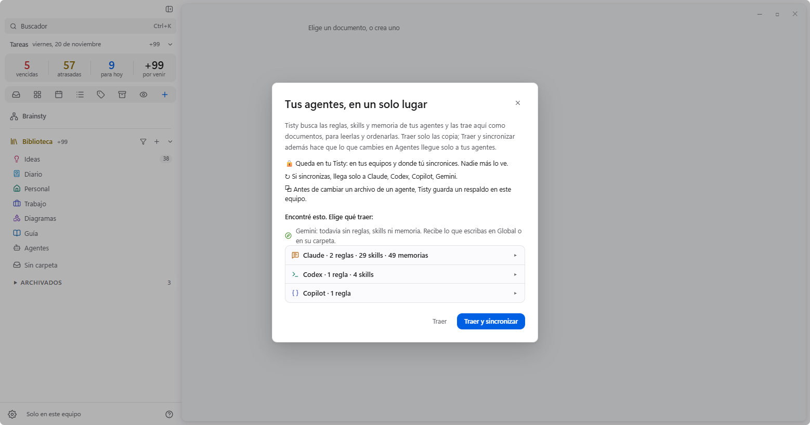

Tisty 1.49 trae tres cosas grandes:

- **La carpeta Agentes.** Las reglas, las skills y la memoria de Claude Code, Codex, GitHub Copilot, Gemini y Cursor, a la vista en un solo lugar y, si quieres, sincronizadas con sus archivos.
- **Brainsty.** Lo que une todo lo que guardas. Enlazas un documento con otro, citas una tarea dentro de un documento, y con eso Tisty arma una sola red: tú la ves y la recorres, y tu agente la lee por MCP para encontrar más leyendo menos.
- **El historial de cada documento.** Ves qué cambió y quién lo cambió, y vuelves a una versión anterior.

Y varias que se notan todos los días: una Configuración ordenada, recordatorios para que tu agente no se olvide de anotar, y arreglos en el editor. Todo sigue en tu equipo, en Markdown y sin cuenta, y sirve igual si trabajas con un agente o por tu cuenta.

## Tus agentes, en un solo lugar

Yisset trabaja con Claude Code, Codex y GitHub Copilot, y cada uno lee sus reglas de su propio archivo, en una carpeta distinta. Cambiar una regla en todos era abrir tres archivos, y tarde o temprano uno quedaba atrás.

La carpeta **Agentes**, arriba en la Biblioteca, trae esos archivos a Tisty como documentos, con sus skills y su memoria. Tienes dos maneras de usarla:

- **Traer** los copia, para leerlos, buscarlos y ordenarlos. Tus agentes siguen leyendo sus archivos de siempre.
- **Traer y sincronizar** además lleva a cada agente lo que cambias en Tisty, con un respaldo antes de cada escritura.

Cada regla abre con su ficha: qué agente la lee, en qué archivo se escribe, cuántos respaldos tiene y si está al día. Desde ahí la editas, ves sus respaldos o pausas la sincronización con ese agente.

Una regla escrita en **Global** llega a todos tus asistentes: Yisset escribe «Responde en español» una vez, y queda en el archivo de cada uno. Un cambio hecho por fuera de Tisty nunca se pisa. Y cuando le pide a su agente que agregue una regla, el agente no la escribe: el cambio espera en la ficha hasta que ella lo aprueba.

Cada equipo decide qué aplica, y Tisty no lee nada de tus agentes hasta que haces clic en la carpeta.

## Brainsty: lo que une todo lo que guardas

Brainsty no es una vista más. Es lo que Tisty sabe de cómo se conecta lo que guardas: qué documento nombra a cuál, qué tarea cita, qué etiqueta comparten. Antes cada unión vivía dentro de su archivo, y el mapa lo llevabas en la cabeza. Ahora está en un solo lugar, que ves tú y lee tu agente.

### Las uniones las haces al escribir

Marisol tiene «Arreglos de la casa», un documento con el techo, la plomería y los presupuestos. Mientras escribe, pone dos corchetes y unas palabras de un título, y el documento queda enlazado a «Notas de la canaleta»; si después lo renombra, el enlace sigue llegando. Junto a cada documento, **Enlazado desde** le dice quién lo nombra.

En el mismo documento, el menú / cita la tarea «Pedir presupuesto del techo» como una tarjeta viva: su fecha, sus pasos y una casilla que marca ahí mismo. Y **Copiar enlace** le da una dirección para llegar a ese documento desde un chat, el navegador o su agente, aunque lo cambie de carpeta.

### La ves como una sola red

Marisol abre **Brainsty**, bajo las vistas de tareas en la barra lateral. Todo lo que guarda está ahí: los documentos como cuadrados, las tareas como círculos del color de su lista, las etiquetas como puntos tenues.

- **De lejos** es un mapa de sus proyectos, que gira despacio como un globo.
- **De cerca** aparece cada título, y un clic abre la ficha de cada cosa: qué es, sus fechas, lo que apunta a ella y su enlace.
- **Lo que alguien escribió pesa más:** una cita o una mención acercan dos cosas, y una etiqueta en común casi no las mueve.

La ves en movimiento en [la portada de tisty.app](https://www.tisty.app/es/).

### Une lo que nadie unió, sin IA

Jaime anota «La imrpesora nueva no imprime en color», y una semana después llega una tarea para instalar la impresora nueva. Nadie las enlazó, pero hablan de lo mismo.

Brainsty las junta con una curva ámbar, aparte de toda línea que alguien escribió, y la ficha dice por qué: dos palabras poco comunes en común, un error de tipeo, o una pareja de una lista fija de palabras español–inglés. Detrás no hay ningún modelo de IA: son reglas, y todo corre en tu equipo.

### Tu agente recorre la misma red

La red que tú ves es la que lee tu agente por el servidor MCP de Tisty, y lo que él escribe queda unido en ella igual que lo tuyo.

Mario le pregunta a su agente cómo renovó el certificado del sitio el año pasado. El agente lo encuentra con una sola búsqueda, el Archivo incluido, y ve cómo se conecta sin abrir nada. De un documento lee primero su ficha, con sus secciones y quién lo cita, y después solo la parte que necesita. Lo que Tisty cree que se parece le llega aparte, así que nunca lo confunde con un enlace que alguien escribió.

En el MCP, buscar, listar y ver el índice de un documento eran varias herramientas, y ahora son una sola; leer una tarea o un documento, otra.

## Cada documento guarda su historial

Lucas le pide a su agente que ordene «Paseos del sábado», y el documento queda sin los horarios. En el panel junto al documento, **Ver el historial** lista sus versiones anteriores, la más nueva primero, con quién escribió cada una: Lucas, o Claude Code.

- **Qué cambió** marca en rojo lo que se quitó y en verde lo que se puso.
- **Volver a esta versión** lo trae de vuelta.

Sirve igual sin agente: si fue Lucas quien borró un párrafo la semana pasada, ese párrafo sigue en una versión de antes.

Tisty guarda una versión cuando alguien escribe después de media hora sin cambios, o cuando cambia quien escribe. Las versiones quedan en ese equipo, 30 días salvo que elija menos, y **Vaciar el historial** se lleva un texto que borró a propósito.

## También en esta versión

- **Tu agente no se olvida de anotar.** Si agregas los recordatorios en Configuración › Asistentes, cada sesión empieza con las tareas que tu agente dejó abiertas, y un turno que cambió archivos sin anotar nada en Tisty se le devuelve una vez.
- **Lo que apartas queda aparte.** Una tarea que ocultaste o descartaste, y tu diario, no están en la red ni le llegan a tu agente.
- **Configuración, en orden.** Once páginas en cuatro grupos, un Resumen que pone primero lo que pide algo de ti y un buscador para cualquier ajuste.
- **Ideas, con su ampolleta.** La Lluvia de ideas ahora se llama Ideas.
- **Menos en la barra lateral.** Una carpeta, el Diario o Ideas se pueden ocultar en este equipo.
- **El editor en macOS.** Las teclas caen donde está el cursor, y Cmd es la tecla de comandos.

## Pruébalo

Tisty es gratis y lo seguirá siendo, bajo la licencia AGPL-3.0, para Windows y macOS, y se actualiza solo. Si ya lo usas, al abrirlo te cuenta lo nuevo. Si llegas recién, la guía de bienvenida tiene una página que te deja probar Brainsty sobre la propia guía.

Gracias a quienes lo usan cada día y me cuentan lo que falta. Brainsty es lo que prometí la vez anterior, y ya está aquí.
