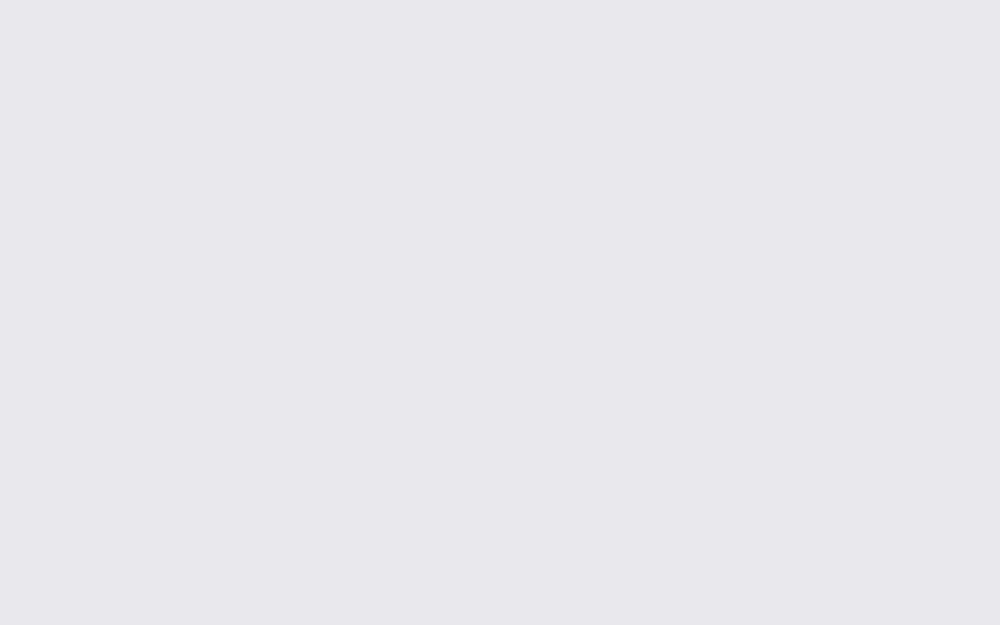
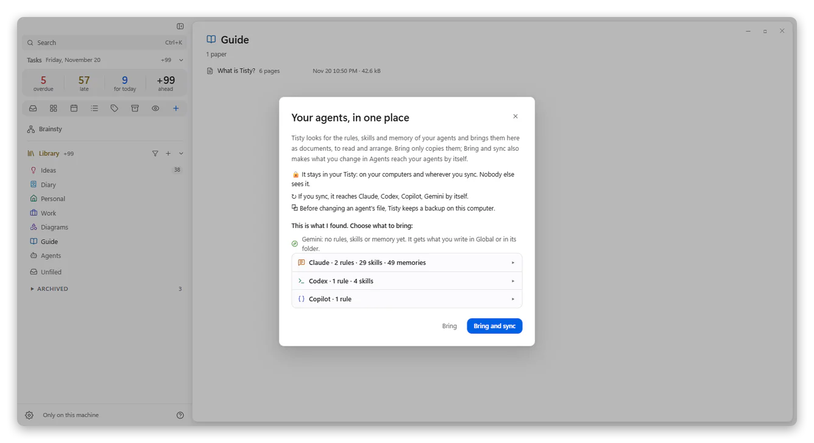

I started building Tisty to solve a problem of my own, and little by little I saw it was not only mine.

You keep a document on the house repairs, a task to ask for the roof quote and another on the gutter, and nothing tells you they are about the same thing. Each tie lives inside its own file, and you hold the map in your head.

Your agent rewrites a document to tidy it and leaves out the one line you needed. A week later you want it back, and nobody kept it.

And every agent you use reads its rules from a file of its own, CLAUDE.md here and AGENTS.md there, so the same rule is written three times and drifts apart.

Tisty was made for that:

- what you keep is joined as you write, and you see it as one map;
- what nobody tied but is about the same thing shows apart, with its why and with no AI;
- every document keeps what it said before, on your computer;
- your agents' rules live in one place, and a change your agent wants waits for you;
- your agent walks that same map instead of reading everything;
- all of it in Markdown on your disk, with no account.

This is what I wanted to tell you.

## Everything you keep, joined

Marisol keeps «House repairs», a document with the roof, the plumbing and the quotes. While writing, she types two brackets and a few words of a title, and the document links to «Gutter notes»; if she renames it later, the link still gets there. In the same document, the / menu cites the task «Ask for the roof quote» as a live card: its date, its steps and a box she ticks right there. Beside each document, **Linked from** tells her who names it.

Then she opens **Brainsty**, under the task views in the sidebar. Everything she keeps is there as one network: documents as squares, tasks as circles in their list's colour, tags as faint dots. From afar it is a map of her projects, slowly turning like a globe while a few lights walk its lines. Up close, every title shows and each thing is its own icon. A click opens its card, with what it is, its dates, what points at it and its link; **Open** takes her there.

What someone wrote weighs most. A citation or a mention draws two things together and shows strong; a shared tag barely moves them. And what Marisol put away stays away: a task she hid or dropped, and her diary, are not in the network.

## What is alike, with no AI

Some things are about the same thing and nobody tied them. Jaime jots «La imrpesora nueva no imprime en color», and a week later a task arrives to install the new printer. Or he writes «Pagar la cuenta del agua» and his agent writes «Pay the water bill».

Brainsty joins them with an amber curve, apart from every line someone wrote, and the card says why: two uncommon words in common, a word one letter away from another, or a pair from a fixed Spanish–English word list made by linguists. There is no model behind it. It reads only the prose you wrote, never code or your agents' files, and it all runs on your computer.

## Go back to what a document said

Lucas asks his agent to tidy «Saturday walks» and it leaves out the times. In the panel beside the document, **See the history** lists its earlier versions, newest first, with who wrote each one: Lucas, or Claude Code. **What changed** marks in red what the agent took out and in green what it put in, and **Go back to this version** brings it back.

Tisty keeps a version when someone writes after a quiet half hour, or when the one writing changes, so what the agent replaced never mixes with what Lucas wrote. The versions stay on that computer, 30 days unless he chooses fewer, and **Empty the history** takes away a text he deleted on purpose.

## Your agents' rules, in one place

Yisset works with Claude Code, Codex and Gemini, and each one reads its rules from its own file. The **Agents** folder, at the top of the Library, brings those files into Tisty as documents, with their skills and their memory. **Bring** copies them, to read and arrange them; **Bring and sync** also writes a rule she changes once into each agent's file, with a backup before every overwrite.

A rule in **Global** reaches every assistant on the computer. A change made outside Tisty is never written over. And when Yisset asks her agent to add a rule, it does not write it: the change waits on the card, beside what she approved, until she says yes.

Each computer decides what it applies, and nothing is read from her agents until she clicks the folder.

## Your agent walks it, without reading it all

The network you see is the index your agent reads. With a single search it reaches everything, the Archive included; it reads a document's card, with its sections and who cites it, before reading only the part it needs; and it gets what Tisty thinks is alike apart, so it never takes it for a link someone wrote.

If you add Tisty's reminders in **Settings › Assistants**, every session starts with the tasks your agent left open, and a turn that changed files without noting anything in Tisty is handed back once. And what you put away stays away from it too: a hidden task named inside your writing reaches your agent as «a task out of sight», and comes back intact if it rewrites that document.

## Try it

Tisty is free and will stay free, under the AGPL-3.0 licence, for Windows and macOS, and it updates itself. If you already use it, it tells you what is new when it opens. If you are new, the welcome guide starts with you and your agent, and has a page that lets you try Brainsty on the guide itself.

Thank you to everyone who uses it every day and tells me what is missing. Brainsty is what I promised last time, and it is here.
