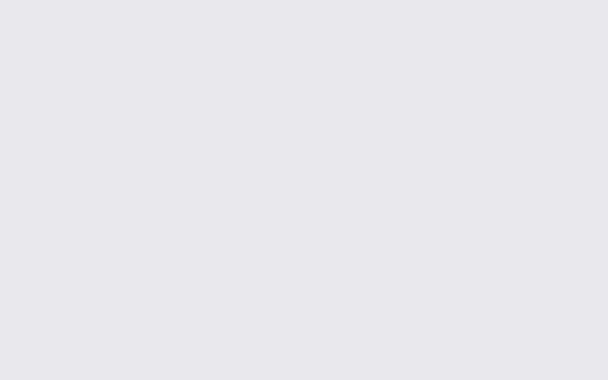

Comencé a desarrollar Tisty para resolver un problema personal, y fui viendo que ese problema no era solo mío.

Guardas un documento con los arreglos de la casa, una tarea para pedir el presupuesto del techo y otra sobre la canaleta, y nada te dice que hablan de lo mismo. Cada unión vive dentro de su archivo, y el mapa lo llevas en la cabeza.

Tu agente reescribe un documento para ordenarlo y deja fuera la única línea que necesitabas. Una semana después la quieres de vuelta, y nadie la guardó.

Y cada agente que usas lee sus reglas de un archivo propio, CLAUDE.md aquí y AGENTS.md allá, así que la misma regla queda escrita tres veces y cada copia se va por su lado.

Tisty nació para eso:

- lo que guardas queda unido mientras escribes, y lo ves como un solo mapa;
- lo que nadie unió pero habla de lo mismo aparece aparte, con su porqué y sin IA;
- cada documento guarda lo que decía antes, en tu equipo;
- las reglas de tus agentes viven en un solo lugar, y un cambio que quiere tu agente te espera;
- tu agente recorre ese mismo mapa en vez de leerlo todo;
- todo en Markdown en tu disco, sin cuenta.

Esto es lo que te quería contar.

## Todo lo que guardas, unido

Marisol tiene «Arreglos de la casa», un documento con el techo, la plomería y los presupuestos. Mientras escribe, pone dos corchetes y unas palabras de un título, y el documento queda enlazado a «Notas de la canaleta»; si después lo renombra, el enlace sigue llegando. En el mismo documento, el menú / cita la tarea «Pedir presupuesto del techo» como una tarjeta viva: su fecha, sus pasos y una casilla que marca ahí mismo. Junto a cada documento, **Enlazado desde** le dice quién lo nombra.

Después abre **Brainsty**, bajo las vistas de tareas en la barra lateral. Todo lo que guarda está ahí como una sola red: los documentos como cuadrados, las tareas como círculos del color de su lista, las etiquetas como puntos tenues. De lejos es un mapa de sus proyectos, que gira despacio como un globo mientras unas luces recorren sus líneas. De cerca aparece cada título y cada cosa es su propio ícono. Un clic abre su ficha, con qué es, sus fechas, lo que apunta a ella y su enlace; **Abrir** la lleva ahí.

Lo que alguien escribió pesa más. Una cita o una mención acercan dos cosas y se ven marcadas; una etiqueta en común casi no las mueve. Y lo que Marisol apartó queda aparte: una tarea que ocultó o descartó, y su diario, no están en la red.

## Lo que se parece, sin IA

Hay cosas que hablan de lo mismo y nadie las unió. Jaime anota «La imrpesora nueva no imprime en color», y una semana después llega una tarea para instalar la impresora nueva. O escribe «Pagar la cuenta del agua» y su agente anota «Pay the water bill».

Brainsty las une con una curva ámbar, aparte de toda línea que alguien escribió, y la ficha dice por qué: dos palabras poco comunes en común, una palabra a una letra de otra, o una pareja de una lista fija de palabras español–inglés hecha por lingüistas. Detrás no hay ningún modelo. Solo lee la prosa que escribiste, nunca el código ni los archivos de tus agentes, y todo corre en tu equipo.

## Vuelve a lo que decía un documento

Lucas le pide a su agente que ordene «Paseos del sábado» y lo deja sin los horarios. En el panel junto al documento, **Ver el historial** lista sus versiones anteriores, la más nueva primero, con quién escribió cada una: Lucas, o Claude Code. **Qué cambió** marca en rojo lo que el agente quitó y en verde lo que puso, y **Volver a esta versión** lo trae de vuelta.

Tisty guarda una versión cuando alguien escribe después de media hora sin cambios, o cuando cambia quien escribe, así que lo que reemplazó el agente nunca se mezcla con lo que escribió Lucas. Las versiones quedan en ese equipo, 30 días salvo que elija menos, y **Vaciar el historial** se lleva un texto que borró a propósito.

## Las reglas de tus agentes, en un solo lugar

Yisset trabaja con Claude Code, Codex y Gemini, y cada uno lee sus reglas de su propio archivo. La carpeta **Agentes**, arriba en la Biblioteca, trae esos archivos a Tisty como documentos, con sus skills y su memoria. **Traer** los copia, para leerlos y ordenarlos; **Traer y sincronizar** además escribe la regla que cambia una vez en el archivo de cada agente, con un respaldo antes de cada sobrescritura.

Una regla en **Global** llega a cada asistente del equipo. Un cambio hecho por fuera de Tisty nunca se pisa. Y cuando Yisset le pide a su agente que agregue una regla, no la escribe: el cambio espera en la ficha, junto a lo que ella aprobó, hasta que dice que sí.

Cada equipo decide qué aplica, y no se lee nada de sus agentes hasta que hace clic en la carpeta.

## Tu agente la recorre, sin leerlo todo

La red que tú ves es el índice que lee tu agente. Con una sola búsqueda llega a todo, el Archivo incluido; lee la ficha de un documento, con sus secciones y quién lo cita, antes de leer solo la parte que necesita, y recibe aparte lo que Tisty cree que se parece, así que nunca lo confunde con un enlace que alguien escribió.

Si agregas los recordatorios de Tisty en **Configuración › Asistentes**, cada sesión empieza con las tareas que tu agente dejó abiertas, y un turno que cambió archivos sin anotar nada en Tisty se le devuelve una vez. Y lo que apartas también queda lejos de él: una tarea oculta nombrada dentro de lo que escribiste le llega como «a task out of sight», y vuelve intacta si reescribe ese documento.

## Pruébalo

Tisty es gratis y lo seguirá siendo, bajo la licencia AGPL-3.0, para Windows y macOS, y se actualiza solo. Si ya lo usas, al abrirlo te cuenta lo nuevo. Si llegas recién, la guía de bienvenida empieza contigo y tu agente, y tiene una página que te deja probar Brainsty sobre la propia guía. Y si prefieres trabajar por tu cuenta, sin agente, Brainsty, el historial y todo lo demás son igual de tuyos.

Gracias a todos los que lo usan cada día y me cuentan lo que falta. Brainsty es lo que prometí la vez anterior, y ya está aquí.
