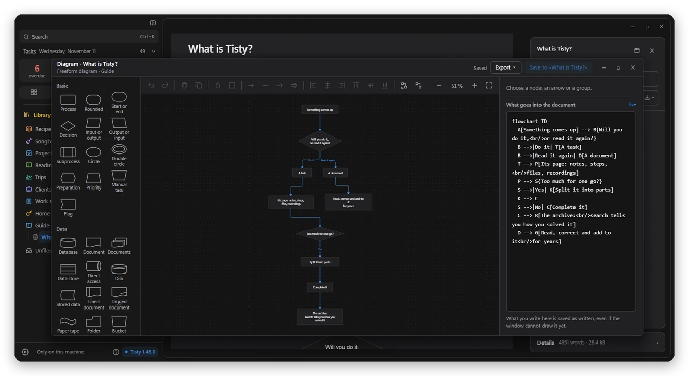
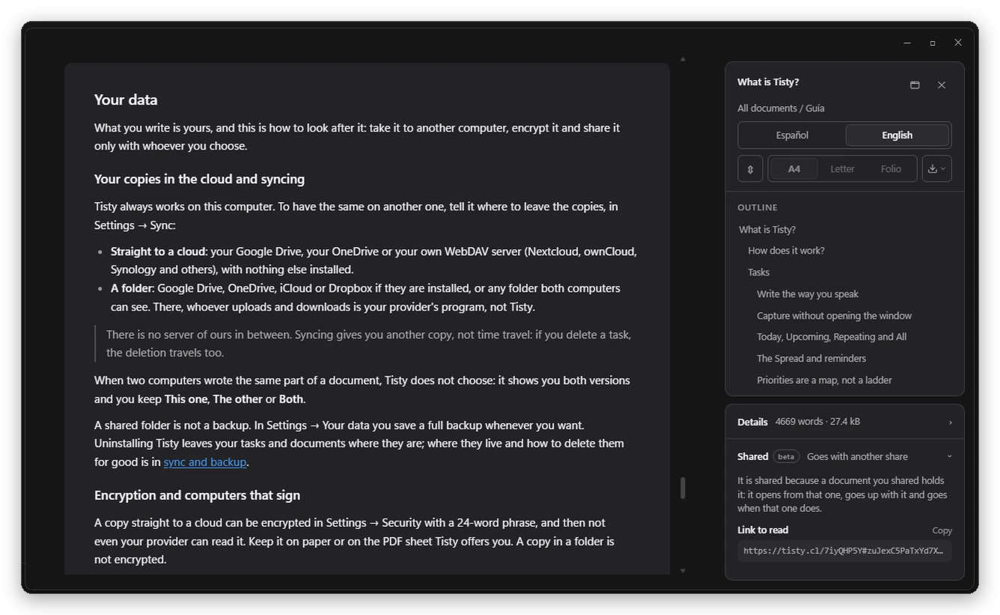

It is Friday afternoon and the site's certificate expires. Again. You renewed it a year ago and there was an odd step, but you did not write it down anywhere: not in the terminal, not in the chat, not in your notebook. The same goes for the bank paperwork every March, the pet's vaccine, the router. How did I do it that time?

With an AI agent it happens every day. Something urgent comes up, you switch topics, and when you come back: where were we? Yesterday it knew everything; today it remembers nothing, and the NOTES.md you made as a patch goes stale in three days.

And then there are ideas. They come while you are on something else, you jot them wherever they land, and one day you find yourself in a brainstorm, not knowing where each one ended up.

**Tisty was made for that:**

- An idea is jotted down in a second and waits in Brainstorm until you know what to do with it.
- A task does not disappear when you finish it: it stays in the Archive, and months later a search tells you how you did it. If it comes back every year, like that certificate, each round stays on the same page.
- What you read again, the manual of a system or the decisions of a project, lives in one document per subject.
- Your agent connects over MCP, picks up where it left off and reads only what it needs.
- It all stays on your computer, in Markdown: no account, no subscription, nobody watching how you use it, and what cannot leave your company does not.

Over twelve versions since late October, that memory has grown in every direction. This is what I wanted to tell you.

## Your agent no longer starts from scratch

Marisol opens Claude Code on Monday and asks where they left off. The agent sees what changed since the last session and goes back to the task it was on, *Migrate payments to v2*, with its steps ticked and Friday's note: *the webhook fails with old signatures; retrying, ruled out*. It also tells Marisol what presses, overdue first, and carries on from there.

It does not need to read everything again. A long task reaches it in parts, with its digest and its latest note, and a big document by its outline and the one section it asked for: a fraction of what reading the whole file would cost. It can work any task the way it works a document, describing it, ordering its steps, writing its page, but what settles it stays yours: ticking your steps, finishing it and moving its day. It never deletes anything. What it thinks had its day it marks with the reason, and you decide.

It works with Claude Code, GitHub Copilot, Codex, Cursor and any assistant that speaks MCP.

## Everyone, their own memory

A PM does not work like a developer, nor a QA like a tech lead. Each person has their own Tisty, with their documents, what they learned and their tasks, and their agent works with that: Jaime keeps every decision in *Checkout decisions* with its date and its why, and when someone asks a month later why it was decided, the agent finds it and quotes it instead of reopening the debate.

And it is not only for work. The bank paperwork that comes back every year, the recipe that finally came out right, the trip you are planning: next year, Tisty tells you how you did it.

## Ideas have a place of their own

Some thoughts are not tasks or documents yet. With 1.47, press Ctrl + Shift + Space wherever you are, Tab to switch from task to idea, and type it: it waits as a sticky note of up to 140 characters, with its date and its colour, on the Brainstorm sheet pinned atop your library.

You reorder them by dragging, and when an idea's moment comes, it becomes a task or goes into the document on its subject as the same sticky note. Your agent can brainstorm with you too and jot only the ideas you keep. Ask it to sort them and it proposes which belong together, which become a task and which go into a document.

## What you know, drawn and in your language

A diagram is drawn with the mouse, no code needed: freeform diagrams with every Mermaid shape, mind maps, database schemas and class diagrams. They open in a window of their own, the drawing beside its text, and are saved as the same Mermaid that GitHub, Notion, Obsidian and your agent read. Arrows go round what is in their way, and their words never cover each other.

Tables are edited on the page, with number, money, date or option columns, and what you copy from Excel or Google Sheets comes in as a table. You write straight on, because the Markdown stays out of sight until you ask for it. And a document can be in several languages and read as one: you switch language at the same section, and when someone adds a translation, it waits for your review with the name of whoever made it.

## Private, encrypted and signed

What Tisty keeps in your Google Drive, your OneDrive or your WebDAV server can be encrypted with a 24-word phrase only you know: neither your provider nor anyone at Tisty can read it. Your other computers get the key on their own, and a new one joins with a code.

And when it is time to share, like a handover from a PM to their PO or from development to QA, it does not go pasted into a chat. Folio hands it over with a link encrypted on your computer before it leaves, in the languages you choose, signed by your identity: a key that lives only on your computers, with no account and no email. Whoever gets it knows it comes from you and sees who edited it, each with their own signature.

Tisty sends your data nowhere. What your agent reads goes wherever that agent goes, so use one your company allows.

## Try it

Tisty is free and open source, for Windows and macOS, and updates itself. If you already use it, 1.47 tells you what is new when it opens. If you are new, the welcome guide walks you through it and shows you how to connect your agent. Every version, with all its changes, is in the changelog.

Thank you to everyone who uses it every day. Tisty is made so that what you learn, you and your agent, is not lost from one day to the next.
