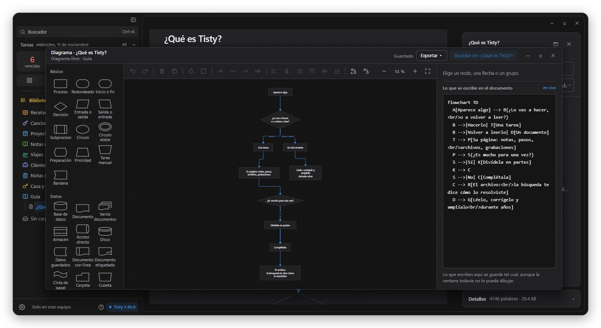
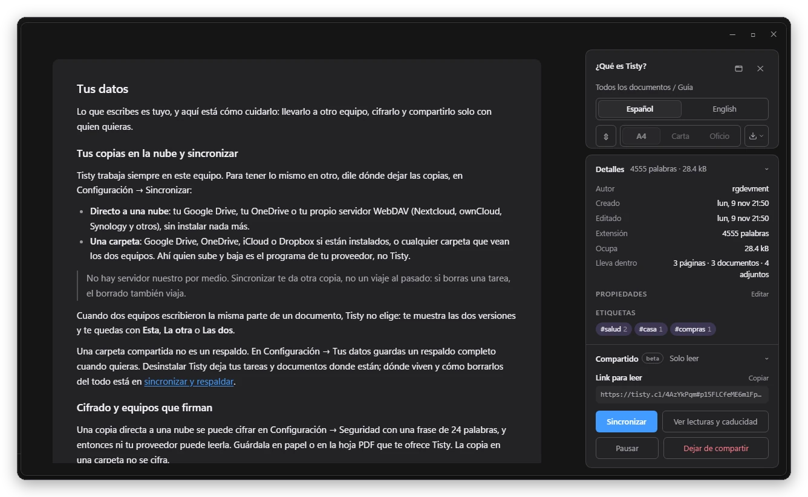

Es viernes en la tarde y vence el certificado del sitio. Otra vez. Lo renovaste hace un año y había un paso raro, pero no lo anotaste en ninguna parte: ni en la terminal, ni en el chat, ni en la libreta. Lo mismo con el trámite del banco cada marzo, la vacuna de la mascota, el router. ¿Cómo lo hice esa vez?

Con un agente de IA pasa todos los días. Sale algo urgente, cambias de tema, y al volver: ¿en qué estábamos? Ayer lo sabía todo; hoy no recuerda nada, y el NOTES.md que armaste de parche se queda viejo a los tres días.

Y están las ideas. Llegan mientras haces otra cosa, las anotas donde caiga, y un día te encuentras en una lluvia de ideas sin saber dónde quedó cada una.

**Tisty nació para eso:**

- Una idea se anota en un segundo y te espera en la Lluvia de ideas hasta que sepas qué hacer con ella.
- Una tarea no desaparece al terminarla: queda en el Archivo, y meses después una búsqueda te dice cómo lo hiciste. Si se repite cada año, como ese certificado, cada vuelta queda en la misma página.
- Lo que vuelves a leer, el manual de un sistema o las decisiones de un proyecto, vive en un documento por tema.
- Tu agente se conecta por MCP, retoma donde quedó y lee solo lo que necesita.
- Todo queda en tu equipo, en Markdown: sin cuenta, sin suscripción, sin que nadie mire cómo lo usas, y lo que no puede salir de tu empresa no sale.

En doce versiones, desde fines de octubre, esa memoria creció en todas direcciones. Esto es lo que te quería contar.

## Tu agente ya no empieza de cero

Marisol abre Claude Code el lunes y pregunta en qué quedaron. Su agente ve qué cambió desde la última sesión y vuelve a la tarea en la que estaba, *Migrar pagos a v2*, con sus pasos marcados y la nota del viernes: *el webhook falla con firmas viejas; reintentar, descartado*. Le cuenta también qué apremia, lo vencido primero, y sigue desde ahí.

No necesita releerlo todo. Una tarea larga le llega por partes, con su resumen y su última nota, y un documento grande, por su índice y la sección que pidió: una fracción de lo que costaría leer el archivo entero. Puede trabajar cualquier tarea como un documento, describirla, ordenar sus pasos, escribir su página, pero lo que la cierra sigue siendo tuyo: marcar tus pasos, terminarla y moverle el día. Nunca borra nada. Lo que cree que ya cumplió su vida lo marca con el motivo, y decides tú.

Funciona con Claude Code, GitHub Copilot, Codex, Cursor y cualquier asistente con MCP.

## Cada quien, su memoria

Una PM no trabaja como un desarrollador, ni un QA como un líder técnico. Cada persona tiene su propio Tisty, con sus documentos, sus aprendizajes y sus tareas, y su agente trabaja con eso: Jaime guarda en *Decisiones de checkout* cada decisión con su fecha y su porqué, y cuando un mes después alguien pregunta por qué, su agente la encuentra y la cita en vez de reabrir el debate.

Y no es solo para el trabajo. El trámite del banco que vuelve cada año, la receta que por fin salió bien, el viaje que estás armando: el año siguiente, Tisty te dice cómo lo hiciste.

## Las ideas tienen su lugar

Algunas ocurrencias todavía no son tareas ni documentos. Con 1.47, pulsas Ctrl + Shift + Space donde estés, Tab para pasar de tarea a idea, y la escribes: queda como una nota adhesiva de hasta 140 caracteres, con su fecha y su color, en la Lluvia de ideas, fija arriba de tu biblioteca.

Las ordenas arrastrándolas, y cuando llega su momento, una se vuelve tarea o va al documento de su tema como la misma nota adhesiva. Tu agente también puede hacer una lluvia de ideas contigo y anotar solo las que te quedas. Si le pides que las ordene, te propone cuáles van juntas, cuáles se vuelven tarea y cuáles van a un documento.

## Lo que sabes, dibujado y en tu idioma

Un diagrama se dibuja con el mouse, sin escribir código: diagramas libres con todas las formas de Mermaid, mapas mentales, esquemas de bases de datos y diagramas de clases. Se abren en una ventana propia, con el dibujo al lado de su texto, y se guardan como el mismo Mermaid que leen GitHub, Notion, Obsidian y tu agente. Las flechas rodean lo que tienen en el camino, y sus palabras no se tapan.

Las tablas se editan en la página, con columnas de número, dinero, fecha u opción, y lo que copias de Excel o Google Sheets entra como tabla. Escribes de corrido, porque el Markdown no se ve hasta que lo pides. Y un documento puede estar en varios idiomas y verse como uno solo: cambias de idioma en la misma sección, y si alguien suma una traducción, espera tu revisión con el nombre de quien la hizo.

## Privado, cifrado y firmado

Lo que Tisty guarda en tu Google Drive, tu OneDrive o tu servidor WebDAV se puede cifrar con una frase de 24 palabras que solo tú conoces: ni tu proveedor ni nadie de Tisty puede leerlo. Tus otros equipos reciben la llave solos, y uno nuevo entra con un código.

Y cuando sí toca compartir, como el traspaso de una PM a su PO o de desarrollo a QA, no va pegado en un chat. Folio lo entrega con un link cifrado en tu equipo antes de salir, en los idiomas que elijas, firmado por tu identidad: una llave que vive solo en tus equipos, sin cuenta ni correo. Quien lo recibe sabe que viene de ti y ve quién lo editó, cada quien con su propia firma.

Tisty no envía tus datos a ninguna parte. Lo que lee tu agente va adonde va ese agente, así que úsalo con uno que tu empresa permita.

## Pruébalo

Tisty es gratis y de código abierto, para Windows y macOS, y se actualiza solo. Si ya lo usas, al abrir 1.47 te cuenta las novedades. Si recién llegas, la guía de bienvenida te acompaña paso a paso y te enseña a conectar a tu agente. Cada versión, con todos sus cambios, está en el registro de cambios.

Gracias a quienes lo usan todos los días. Tisty se hace para que lo que aprendes, tú y tu agente, no se pierda de un día para otro.
