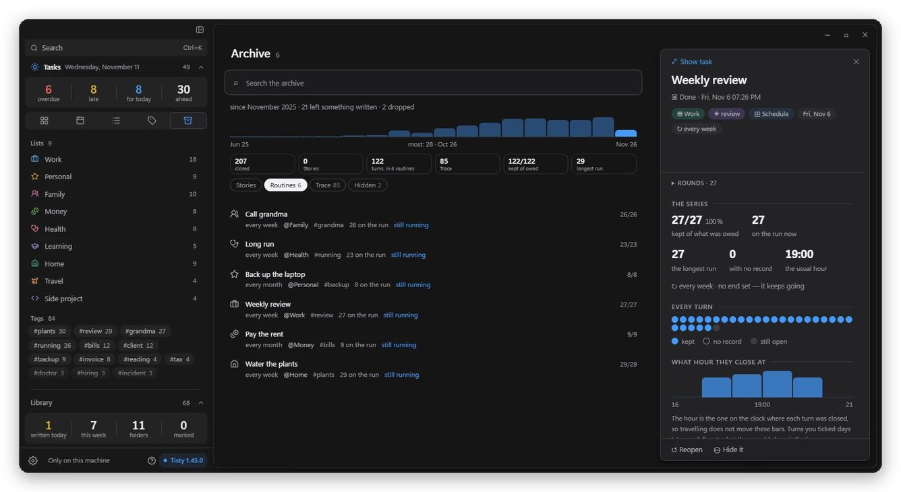
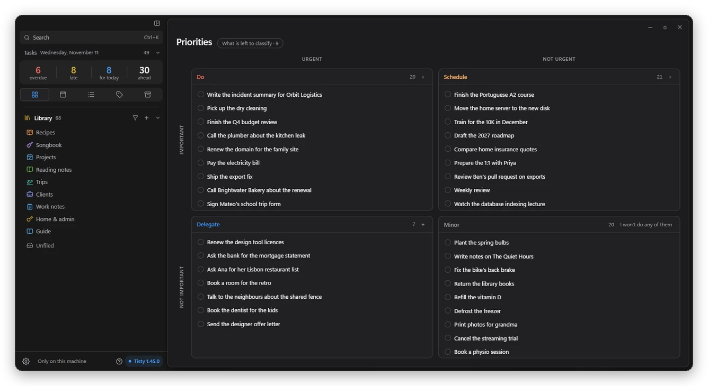

You open your AI agent in the morning and explain the project again. Same stack, same decisions, the same dead end it tried on Friday. It knows every detail better than you do, and it forgot all of them when the session ended.

Meanwhile you are the one who sees the whole: which project is waiting, what was decided, what is left. That lives in your head, or in a NOTES.md that went stale in a week.

And then there is the rest of the day. The appointment you set a reminder for and missed because the app was closed. The three lines you wanted to write about today and never found a place for.

**Tisty was made for that:**

- One working memory for you and your agent: you see the whole, your agent every detail.
- You write on the same page you read, with no editing mode in between.
- What happened today goes in a Diary that no agent opens unless you do.
- A reminder rings at its hour even with Tisty closed, and your phone can remind you too.
- Once a week, a review gathers what is waiting for you.
- It all stays on your computer, in Markdown: no account, no subscription, and what cannot leave your company does not.

I started building Tisty to solve a problem of my own, and little by little I saw it was not only mine. This is what I wanted to tell you.

## You see the whole, your agent every detail

Jaime works on a payments migration with Codex. On Monday Jaime opens Tisty and sees where each project stands: what is overdue, what waits for a decision, which task the agent was on. The agent sees the same memory from the other side: it asks what moved since its last session, opens the task it was on with its steps ticked, and reads only the section it needs instead of every file.

The work is split the way it should be. The agent works the detail: it ticks its steps, notes what it tried and what it ruled out, and keeps what it learns in the document on that subject. Jaime keeps the course: when the agent says a task is done, it waits in To confirm until Jaime closes it or sends it back. Nothing closes without Jaime.

When something comes back months later, either of them can ask how it was solved, and the Archive answers with the task as it was left. The guide Tisty writes for you on first run now opens this way too, with a new section on how you and your agent split the work.

It works with Claude Code, GitHub Copilot, Codex, Cursor and any assistant that speaks MCP.

## You write on the page you read

Marisol is reading the notes on a client and spots a wrong date. Marisol clicks on it and fixes it right there. There is no editing mode and no block to open any more: the page looks the same while you write as when you read it, print it or share it.

Choose a few words and a bar comes up with bold, italic, underline, strikethrough, code, a link and four pens. The slash, or the plus in the margin, inserts everything else, and the handle beside each block drags it, duplicates it or deletes it. Undo takes back what you typed in a row, not key by key, and copying takes the Markdown of what you chose. If you want to see that Markdown, it is one click away.

A task's page is written the same way: a click on a section's hint starts writing there. And a very long page now answers much faster than before.

## A Diary that is only yours

Yisset ends the day with three lines: the call with the school, that Rina finally ate her new food, an idea that came on the bus. Diary, in the Library, always opens on today. Yisset writes in the box on top, it is kept at the end of the day, and the tasks finished that day sit under it. Each year is a book, each month a page.

Yisset does not even need to open the window. In the quick capture, Tab goes from a task to an idea to the diary.

It belongs to Yisset alone. No AI agent sees the diary until Yisset opens it, and even then it only adds to the end of today when asked. It is never shared by link. It begins once every computer Yisset uses has this version, and Tisty says which one is still missing.

## Reminders that ring with Tisty closed

Lucas sets a reminder for Roger's vaccine at ten in the morning and closes Tisty. At ten it rings anyway, as long as the computer is on, and a click on the notice opens the task. If Lucas allows it, an important one comes through Do not disturb.

For the phone, Save to my calendar takes a task with a date to Google Calendar, to Outlook or, on a Mac, to Apple Calendar, and from there the phone reminds Lucas too. Tisty does not connect to the calendar: Lucas saves the event.

## Everything at hand, nothing forgotten

Ctrl + P opens a palette that takes you to any document, task or folder as you type its name. Start with a greater-than sign and it shows the window's actions, each with its shortcut.

Weekly review sits beside your other views. It gathers what waits to be decided, the documents your agent marked as past, and the ones you have not opened in 60 days, and it can remind you every week. The Library shows those forgotten documents too, and opens one at random when you feel like rediscovering something.

And when you need a document beside your work, Open in a window of its own shows it read only, in a light viewer that comes to the front. Edit takes you back to it in the main window.

## What comes next

I am working on Brainsty, the brain of Tisty: everything you keep, with what joins it, drawn as one network. You will see it from afar, as a map of all your projects. Your agent will read it up close, as an index that tells it where to look without reading everything. It has no date yet; when it is ready, I will tell you here.

## Try it

Tisty is free and will stay free, under the AGPL-3.0 licence, for Windows and macOS, and it updates itself. If you already use it, 1.48 tells you what is new when it opens. If you are new, the welcome guide starts with you and your agent and shows you how to connect it. Every version, with all its changes, is in the changelog.

Thank you to everyone who uses it every day. Tisty is made so that neither you nor your agent starts from zero.
