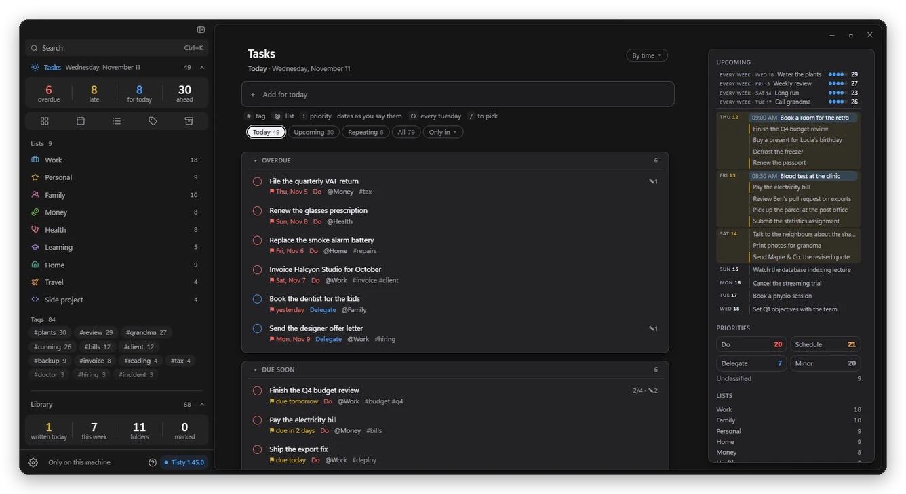

I started building Tisty to solve a problem of my own, and little by little I saw it was not only mine.

Working with an AI agent changed how I work. I no longer write every line: I decide what gets done, review what came out and move between projects. The agent knows the details better than anyone; I am the one who sees the whole. We are an architect and a specialist.

But each of us kept our part in a different place. What the agent knew lived in files it wrote for itself and I never read. What I knew lived in my head, or in notes it read whole or not at all. Every session, someone had to explain everything again.

Tisty 1.48 is the place in between: a shared working memory. The same memory, read in two ways. This is what I wanted to tell you.

## You, the architect: the whole picture, at a glance

An architect does not lay every brick, but has to see the whole building. That is why your side of Tisty is visual.

You open **Today** and see what is overdue, what slipped and what is due, across all your projects at once. A task keeps its ticked steps and what was noted along the way, and once finished it goes whole to the **Archive**. A document is a pleasure to read: headings, colours, callouts that bring out what matters, diagrams and tables, instead of a wall of text.

With 1.48 you lead with less friction. You write on the same page you read, with no editing mode in between. **Ctrl + P** takes you to any document, task or folder as you type its name. A document opens in a window of its own, read only, beside your work. And the **Weekly review** gathers what waits to be decided, the documents your agent marked as past and the ones you have not opened in 60 days: every week you see what came loose before it gets lost.

Nothing closes without you. When your agent says a task is done, it waits in **To confirm** until you review it and close it, or send it back.

## Your agent, the specialist: just what it needs

A specialist does not need to see the whole building every morning. It needs to know where it left off and what is next. That is why its side of Tisty is specific.

Your agent comes in over MCP, through a program that runs on your computer. It asks what moved since last time, opens the task it was on and reads what it noted: what it tried and what it already ruled out, so it does not repeat it. Of a long document it reads the outline first and then only the section it needs, a fraction of what reading it whole would cost.

And when it writes, it writes for you: Tisty asks it to keep things visual, ordered and easy to read, in the same language you use, and everything it writes is signed with its name. It works with Claude Code, GitHub Copilot, Codex, Cursor and any assistant that speaks MCP.

## The memory belongs to both

Jaime runs three projects with an agent on each. On Monday Jaime explains nothing to anyone: Tisty shows where each project stands, and each agent starts from what moved and from the task it was on. When something comes back months later, either of them asks how it was solved, and the Archive answers with the task as it was left.

That memory is yours. It all stays on your computer, in Markdown any program opens, with no account and no server in between. And some things belong to no one else: the **Diary**, new in 1.48, is for what happened today, and no agent sees it until you open it yourself.

For what has a time, a reminder rings even with Tisty closed, and **Save to my calendar** takes the task to Google Calendar, to Outlook or, on a Mac, to Apple Calendar, so your phone reminds you too.

## What comes next

I am working on Brainsty, the brain of Tisty: everything you keep, with what joins it, drawn as one network. The architect will see it from afar, as a map of every project. The specialist will read it up close, as an index that tells it where to look without reading everything. It has no date yet; when it is ready, I will tell you here.

## Try it

Tisty is free and will stay free, under the AGPL-3.0 licence, for Windows and macOS, and it updates itself. If you already use it, 1.48 tells you what is new when it opens. If you are new, the welcome guide starts with you and your agent and shows you how to connect it.

Thank you to everyone who uses it every day. Tisty is made so that neither you nor your agent starts from zero.
