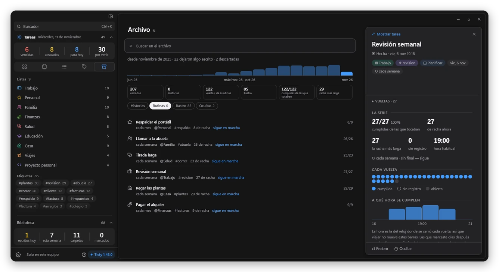
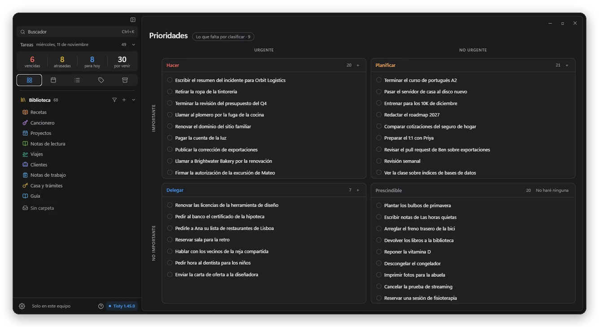

Abres tu agente de IA en la mañana y le vuelves a explicar el proyecto. El mismo stack, las mismas decisiones, el mismo callejón sin salida que probó el viernes. Conoce cada detalle mejor que tú, y los olvidó todos cuando terminó la sesión.

Mientras tanto, quien ve el conjunto eres tú: qué proyecto espera, qué se decidió, qué falta. Eso vive en tu cabeza, o en un NOTES.md que se quedó viejo en una semana.

Y después está el resto del día. La cita a la que le pusiste recordatorio y se te pasó porque la app estaba cerrada. Las tres líneas que querías escribir sobre hoy y nunca encontraron dónde quedarse.

**Tisty nació para eso:**

- Una memoria de trabajo para ti y tu agente: tú ves el conjunto, tu agente cada detalle.
- Escribes en la misma página que lees, sin un modo de edición de por medio.
- Lo que pasó hoy va a un Diario que ningún agente abre si no lo abres tú.
- Un recordatorio suena a su hora aunque Tisty esté cerrado, y el teléfono también puede avisarte.
- Una vez por semana, una revisión reúne lo que te espera.
- Todo queda en tu equipo, en Markdown: sin cuenta, sin suscripción, y lo que no puede salir de tu empresa no sale.

Comencé a desarrollar Tisty para resolver un problema personal, y fui viendo que ese problema no era solo mío. Esto es lo que te quería contar.

## Tú ves el conjunto, tu agente cada detalle

Jaime trabaja en una migración de pagos con Codex. El lunes abre Tisty y ve en qué va cada proyecto: qué está vencido, qué espera una decisión, en qué tarea estaba el agente. El agente ve la misma memoria desde el otro lado: pregunta qué cambió desde su última sesión, abre la tarea en la que estaba con sus pasos marcados y lee solo la sección que necesita, en vez de cada archivo.

El trabajo se reparte como corresponde. El agente se encarga del detalle: marca sus pasos, anota lo que probó y lo que descartó, y guarda lo que aprende en el documento de ese tema. Jaime lleva el rumbo: cuando el agente dice que una tarea está lista, espera en Por confirmar hasta que Jaime la cierra o la devuelve. Nada se cierra sin Jaime.

Cuando algo vuelve meses después, cualquiera de los dos puede preguntar cómo se resolvió, y el Archivo responde con la tarea tal como quedó. La guía que Tisty te escribe la primera vez ahora también abre así, con una sección nueva sobre cómo se reparten el trabajo tú y tu agente.

Funciona con Claude Code, GitHub Copilot, Codex, Cursor y cualquier asistente que hable MCP.

## Escribes en la página que lees

Marisol está leyendo las notas de un cliente y ve una fecha equivocada. Hace clic en ella y la corrige ahí mismo. Ya no hay un modo de edición ni bloques que abrir: la página se ve igual mientras escribes que al leerla, imprimirla o compartirla.

Al elegir unas palabras aparece una barra con negrita, cursiva, subrayado, tachado, código, enlace y cuatro rotuladores. La barra inclinada, o el más del margen, inserta todo lo demás, y el asa junto a cada bloque lo arrastra, lo duplica o lo borra. Deshacer se lleva lo que escribiste seguido, no tecla por tecla, y copiar se lleva el Markdown de lo elegido. Si quieres ver ese Markdown, está a un clic.

La página de una tarea se escribe igual: un clic en la pista de una sección empieza a escribir ahí. Y una página muy larga ahora responde mucho más rápido que antes.

## Un Diario que es solo tuyo

Yisset cierra el día con tres líneas: la llamada del colegio, que Rina por fin se comió su comida nueva, una idea que llegó en el bus. Diario, en la Biblioteca, abre siempre en hoy. Yisset escribe en el cuadro de arriba, queda al final del día, y las tareas terminadas ese día aparecen debajo. Cada año es un libro, cada mes una página.

Ni siquiera hace falta abrir la ventana. En la captura rápida, Tab pasa de tarea a idea y a diario.

Es solo de Yisset. Ningún agente de IA ve el diario hasta que Yisset lo abre, y aun así solo añade al final de hoy cuando se le pide. Nunca se comparte por link. Empieza cuando todos los equipos de Yisset tienen esta versión, y Tisty dice cuál falta.

## Recordatorios que suenan con Tisty cerrado

Lucas pone un recordatorio para la vacuna de Roger a las diez de la mañana y cierra Tisty. A las diez suena igual, mientras el equipo esté encendido, y un clic en el aviso abre la tarea. Si Lucas lo permite, uno importante atraviesa No molestar.

Para el teléfono, Guardar en mi calendario lleva una tarea con fecha a Google Calendar, a Outlook o, en un Mac, al Calendario de Apple, y desde ahí el teléfono también le avisa a Lucas. Tisty no se conecta al calendario: el evento lo guarda Lucas.

## Todo a mano, nada olvidado

Ctrl + P abre una paleta que te lleva a cualquier documento, tarea o carpeta mientras escribes su nombre. Si empiezas con el signo mayor que, muestra las acciones de la ventana, cada una con su atajo.

Revisión semanal está junto a tus otras vistas. Reúne lo que espera una decisión, los documentos que tu agente marcó como pasados y los que no abres hace 60 días, y puede recordártela cada semana. La Biblioteca también te muestra esos documentos olvidados, y abre uno al azar cuando tengas ganas de redescubrir algo.

Y cuando necesitas un documento junto a tu trabajo, Abrir en una ventana aparte lo muestra en solo lectura, en un visor ligero que aparece al frente. Editar te lleva de vuelta a él en la ventana principal.

## Lo que viene

Estoy trabajando en Brainsty, el cerebro de Tisty: todo lo que guardas, con lo que lo une, dibujado como una sola red. Tú la verás de lejos, como un mapa de todos tus proyectos. Tu agente la leerá de cerca, como un índice que le dice dónde mirar sin leerlo todo. Todavía no tiene fecha; cuando esté lista, te lo cuento aquí.

## Pruébalo

Tisty es gratis y lo seguirá siendo, bajo la licencia AGPL-3.0, para Windows y macOS, y se actualiza solo. Si ya lo usas, 1.48 te cuenta lo nuevo al abrirse. Si es tu primera vez, la guía de bienvenida empieza contigo y tu agente, y te muestra cómo conectarlo. Cada versión, con todos sus cambios, está en el registro de cambios.

Gracias a quienes lo usan cada día. Tisty existe para que ni tú ni tu agente empiecen de cero.
