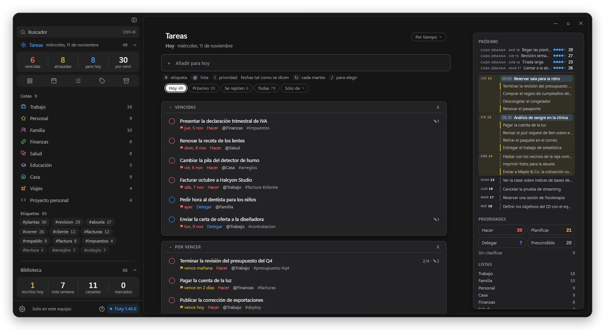

Comencé a desarrollar Tisty para resolver un problema personal, y fui viendo que ese problema no era solo mío.

Trabajar con un agente de IA cambió cómo trabajo. Ya no escribo cada línea: decido qué se hace, reviso lo que salió y me muevo entre proyectos. El agente conoce el detalle mejor que nadie; yo soy quien ve el conjunto. Somos un arquitecto y un especialista.

Pero cada uno guardaba lo suyo en un lugar distinto. Lo que el agente sabía vivía en archivos que escribía para sí mismo y que yo no leía. Lo que yo sabía vivía en mi cabeza, o en notas que él leía enteras o no leía. Cada sesión, alguien tenía que volver a explicarlo todo.

Tisty 1.48 es el lugar del medio: una memoria de trabajo compartida. La misma memoria, leída de dos maneras. Esto es lo que te quería contar.

## Tú, el arquitecto: el conjunto, a la vista

El arquitecto no pone cada ladrillo, pero tiene que ver la obra entera. Por eso lo tuyo en Tisty es visual.

Abres **Hoy** y ves qué está vencido, qué se atrasó y qué toca, en todos tus proyectos a la vez. Una tarea guarda sus pasos marcados y lo que se fue anotando, y al terminarla pasa entera al **Archivo**. Un documento se lee con gusto: títulos, colores, avisos que resaltan lo importante, diagramas y tablas, en vez de un muro de texto.

Con 1.48 lo diriges con menos fricción. Escribes sobre la misma página que lees, sin un modo de edición de por medio. **Ctrl + P** te lleva a cualquier documento, tarea o carpeta mientras escribes su nombre. Un documento se abre en una ventana aparte, en solo lectura, junto a tu trabajo. Y la **Revisión semanal** reúne lo que espera una decisión, los documentos que tu agente marcó como pasados y los que no abres hace 60 días: cada semana ves qué quedó suelto antes de que se pierda.

Nada se cierra sin ti. Cuando tu agente dice que una tarea está lista, espera en **Por confirmar** hasta que la revisas y la cierras, o la devuelves.

## Tu agente, el especialista: lo justo, sin rodeos

El especialista no necesita ver la obra entera cada mañana. Necesita saber dónde quedó y qué le toca. Por eso lo suyo en Tisty es específico.

Tu agente entra por MCP, desde un programa que corre en tu equipo. Pregunta qué cambió desde la última vez, abre la tarea en la que estaba y lee lo que anotó: lo que probó y lo que ya descartó, para no repetirlo. De un documento largo lee primero el índice y después solo la sección que necesita, una fracción de lo que costaría leerlo entero.

Y cuando escribe, escribe para ti: Tisty le pide que lo haga visual, ordenado y fácil de leer, en el mismo lenguaje que usas tú, y todo lo que escribe va firmado con su nombre. Funciona con Claude Code, GitHub Copilot, Codex, Cursor y cualquier asistente que hable MCP.

## La memoria es de los dos

Jaime lleva tres proyectos y un agente en cada uno. El lunes no le explica nada a nadie: abre Tisty y ve en qué va cada proyecto, y cada agente parte de lo que cambió y de la tarea en la que estaba. Cuando algo vuelve meses después, cualquiera de los dos pregunta cómo se resolvió, y el Archivo responde con la tarea tal como quedó.

Esa memoria es tuya. Todo queda en tu equipo, en Markdown que cualquier programa abre, sin cuenta y sin pasar por ningún servidor. Y hay cosas que no son de nadie más: el **Diario**, nuevo en 1.48, es para lo que pasó hoy, y ningún agente lo ve hasta que tú lo abres.

Para lo que tiene hora, un recordatorio suena aunque Tisty esté cerrado, y **Guardar en mi calendario** lleva la tarea a Google Calendar, a Outlook o, en un Mac, al Calendario de Apple, para que también te avise el teléfono.

## Lo que viene

Estoy trabajando en Brainsty, el cerebro de Tisty: todo lo que guardas, con lo que lo une, dibujado como una sola red. El arquitecto la verá de lejos, como un mapa de todos sus proyectos. El especialista la leerá de cerca, como un índice que le dice dónde mirar sin leerlo todo. Todavía no tiene fecha; cuando esté lista, te lo cuento aquí.

## Pruébalo

Tisty es gratis y lo seguirá siendo, bajo la licencia AGPL-3.0, para Windows y macOS, y se actualiza solo. Si ya lo usas, 1.48 te cuenta lo nuevo al abrirse. Si es tu primera vez, la guía de bienvenida empieza contigo y tu agente, y te muestra cómo conectarlo.

Gracias a quienes lo usan cada día. Tisty existe para que ni tú ni tu agente empiecen de cero.
